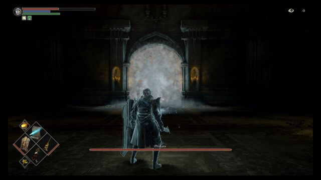
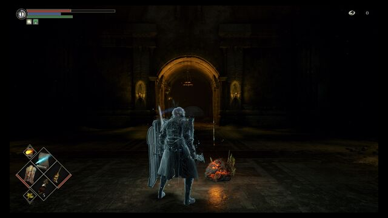
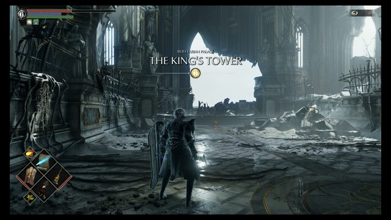
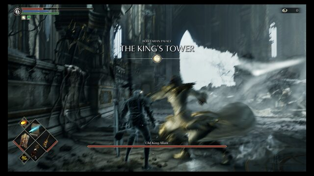

# Event flags

How the save's event-flag system was decoded: where the flags live, how a flag
number maps to a bit, what the flags mean, and what that makes possible. The
runtime side is `src/des_flags.py`; the meanings are compiled into
`flagdb.json` by `tools/build_flagdb.py`.

[← Back to the README](../README.md) · [Research notes](research.md) · [Coverage and limits](coverage.md)

## What was found

The game's Lua scripts (`cp11demonssouls/dvdroot/script/*.lua`) drive every
story event through numbered flags: `proxy:SetEventFlag(id, value)` sets one,
`proxy:IsCompleteEvent(id)` tests it. Boss deaths, NPC quest states, opened
doors and one-shot pickups are all flags in one numbering.

The save stores those flags as **plain bits (LSB first) in fixed-size blobs**,
in two numberings:

```
local  flag id 0..3199       -> bank 0af4946a, bit area * 3200 + id            (area = map - 1)
local  flag id 8192..12287   -> bank 78a5c2d7, bit area * 4096 + (id - 8192)
                                and, for the current map only, a copy at primary bit id
global flag (any other id)   -> primary blob, bit id
```

| Blob (key)  | Bytes  | Layout | Role |
|-------------|--------|--------|------|
| `522ad995`  | 2256   | bit = id; 0–3199 and 8192–12287 are copies of the current map's slots | Boss, NPC, tutorial, shop and counter flags; proven (below). |
| `0af4946a`  | 3200   | 8 maps × 3200 local flags 0–3199 | Every map's own flags: doors, levers, scripted scenes. Proven (below). |
| `78a5c2d7`  | 4096   | 8 maps × 4096 local flags 8192–12287 | Every map's pickups, placed enemies, dialogue progress and talk flags. Proven (below). |

No header, no count: unused bytes are zero. The blobs sit together near the
end of the save's top-level records (between the option floats and the
world-state blob). The options profile has none.

## How it was identified

The eboot's save reader gave the first anchor: it reads exactly these three
blobs into buffers of exactly their sizes (`0x8d0`, `0xc80`, `0x1000` bytes —
visible as `mov $0x8d0/%ecx...` allocation pairs around the `522ad995`,
`0af4946a`, `78a5c2d7` immediates at `eboot+0x3c74f` ff.), so they are
fixed-layout engine state, not per-record data.

The bit mapping was then proven against saves with known game state, with
three independent anchors:

1. **Boss flags match the demon souls each save holds.** The scripts'
   `GetBossFlagCount` (in `global_event.lua`) lists all sixteen boss-death
   flags in world groups. A mid-game save (`DPG`, `DEMONSKILLED=3`, holding
   the Phalanx, Tower Knight and Armour Spider souls) has exactly the flag
   pairs 4096+4103, 4224+4252, 6174+6193 set — death flag and soul flag,
   nothing else. An end-game save (`LOL`, `DEMONSKILLED=15`) has fifteen of
   sixteen boss flags — every one except 4480, the False King, which that
   character never fought.
2. **NPC quest states match each save's story.** `event_define.lua` defines
   each NPC's quest states as flag constants (the Maiden in Black
   `HEROINE_STATE_*` = 16140–16146, Biorr `BIYO_STATE_*` = 16060+, ... 32
   lists in all) and the scripts keep **exactly one state flag set per
   NPC** (`SetNpcStateFlag` lowers the old state and raises the new). Every
   save in the collection obeys this: fresh characters show
   `HEROINE_STATE_ISNOT` (16146) with Biorr `CAPTIVE` (16060); the mid-game
   save shows `WAIT_FOR_PLAYER` (16140); the end-game save shows the second
   Urbain believer `DEAD` (16314, `GOD_BELIEVER_2_STATE_DEAD`), Biorr mid-flight
   with the dragon, Selen searching for her brother — all matching what those
   playthroughs did. (An earlier version of this note called 16314 Scirvir's;
   it is the believer's.)
3. **New Game+ wipes world flags and keeps Nexus ones.** The same character
   before and after finishing the game: every world flag (bosses, doors,
   pickups — everything below ~15000 that belongs to the five worlds) is
   cleared; the Nexus NPC states, the tutorial flags (14050–14312) and the
   "has been to" flags (8084–8090) survive. That is exactly how a New Game+
   behaves in game.

The mapping also explains the two "mystery" 16-byte and 12-byte blobs nearby
(`fb0faeb2`, `739273b8`, `2b87b29a`, `94a8d348`): they churn between saves
seconds apart, so they are session state, not story flags. They are left
untouched.

## Area-local flags

Small flag numbers looked "reused": 200 is "Half hand enemy" in the Nexus
script and "Door to the execution place" in Boletaria's. They are not shared.
Every map has its own flags 0–3199, and the second bank holds them all:

- **The slots.** For ~60 distinct saves from five characters (Kyty's live
  profiles and their timestamped backups), the primary blob's set bits below
  3200 reappear in `0af4946a` at a fixed offset that depends only on the map in
  `MAPUID` (its top byte is the map number): m01 at 0, m02 at 3200, m03 at
  6400, m05 at 12800, m06 at 16000. That is `(map - 1) × 3200`; the bank's
  25600 bits are 8 maps × 3200.
- **The copy.** In every one of those saves, primary bits 0–3199 are
  *exactly* the current map's slot, and primary bits 3200–4095 are never
  set. The engine keeps the current map's local flags in the primary blob and
  the persistent set for every map in the bank.
- **The meanings line up.** A before/after pair around the Dragon God kill
  (`Saves/BeforeDragonBoneSmasher`, `Saves/AfterDragonBoneSmasher`, both saved
  in the Nexus) sets bank bits 17050, 17060–17063, 17111, 17114 and 17202.
  Those are m06 local flags 1050 ("Enter the boss room"), 1060/1061 ("Light
  sword launcher start", the ballistae), 1111 ("PC pulls gram") and 1114
  ("Approaching gram"), all from the m06 script's own comments. The same kill
  set global 6400 (Dragon God defeated), 6403 (Get Soul) and the boss-count
  flags 8050/8071.

So a local flag is only meaningful with its map, and an edit has to write the
map's slot. When the map is the current one it also has to write the primary
copy, because the save would otherwise hold two disagreeing values.
`des_flags.set_local` and the Events tab write both. The [in-game
check](#in-game-check) shows that the game fills the copy from the slot when it
loads, so the slot is the one that counts.

### The second local range: 8192–12287 in `78a5c2d7`

The third bank is the same arrangement for a second range of flag numbers.
On all 13 distinct saves sampled (2026-11-17), primary bits 8192–12287 equal
`78a5c2d7` bits `area × 4096 … + 4095` of the current map, with no mismatch.
So flags 8192–12287 are map-local too, and the "unlabelled globals" in
10240–11800 were really other maps' flags. The Dragon God kill's bits read
again: m06 local 11265–11267 and m01 local 9045. Those are the three pickups
in the Dragon God's room (New Moon Grass ×2, Master's Ring, Legendary
Warrior Soul) and a Blacksmith Boldwin dialogue flag.

What lives in this range:

- **Pickups.** In the map layouts (MSB, below), every treasure event points at
  a part (a corpse or chest object), and that part's entity id is the flag the
  game sets when the item is taken: 10240 + 512 per sub-map, e.g. 10240–10287 in
  Boletaria 1-1. 273 of the 794 set map flags on the end-game save are these.
- **Placed enemies and objects** with entity ids in the range (37 enemies and
  39 objects on the end-game save), most likely "stays dead / stays broken".
- **Dialogue progress** (8192–9999): the talk state machines
  (`script/talk/mXX.talkesdbnd`) read and write them.
- **"Heard" flags** (10111–10238): `TALK_PARAM_ST.eventId`, set when a line
  of dialogue has played.

## Where each flag's meaning comes from

`tools/build_flagdb.py GAME` parses the game's own scripts (CP932 text, no
game files are shipped) and writes `flagdb.json`:

- **Bosses.** `GetBossFlagCount`'s table gives the sixteen death flags; each
  map script's "Get Soul" handler (`OnEvent_4103_1` → `GetRateItem(10110)`,
  `SetEventFlag(5121, 1)` in 3-1, ...) names the paired one-shot soul flag.
- **NPC quest states.** `event_define.lua`'s 32 state lists (`*_flag_list`,
  and five spelled `*Flag_list`: Satsuki, Blacksmith Ed, the Stonefang and
  Dregling merchants, the Filthy Woman) with their per-state comments. The
  file also defines `NPC_STATE_BACKUP_OFFSET = 1000`. `SetNpcStateFlag`
  (`global_event.lua`) treats the first set flag in list order as the current
  state; on every change it clears all the list's +1000 twins, sets the
  outgoing state's twin, sets the new state and clears the old one. The twin
  is therefore the **previous state**, and `SeekForgiveness` restores it when
  the NPC is hostile. Real saves carry these bits for most NPCs (the end-game
  save has 17353 and 17443 set, Thomas's and Boldwin's previous states).
  `events --npc` and the Events tab follow the same steps.
- **Who each list is.** The scripts use development names. The game's own
  name table (`text/ds/_cmn/npc_name.*.ctxt`, English and Japanese) and
  dialogue (`talk_msg.*.ctxt`) identify them:

  | Script list | NPC | Evidence |
  |---|---|---|
  | `yojin` (要人) | Monumental | the official Japanese name |
  | `rogarn` | Sage Freke | his dialogue: "I am Freke. I have been trapped here for an age." |
  | `magic_student` (魔術の徒) | Freke's Apprentice | "please free Sage Freke the Visionary from his cell in Latria" |
  | `syuujin` (囚人) | Graverobber Blige | "You saved me ... I fell for that trap ... I'm Blige", in the Shrine |
  | `half` (ハーフハンド) | Scirvir, the Wanderer | appears through Stonefang tendency judge 60130 |
  | `viraidel` | Rydell | "I left upon my person a keepsake of my late wife" |
  | `noble_woman` (元貴族婦人) | Former Noble's Wife | the official name |
  | `Kojiki_Shop` (乞食(女)) | Filthy Woman | sells in the Valley ("My poor child is hungry") |
  | `DOREISOL_SHOP` (奴隷兵士) | Dregling Merchant | sells in Boletaria 1-1 to 1-3 |
  | `SMITH` | Blacksmith Ed | the smith of the Stonefang script (Boldwin: "another blacksmith at the entrance to Stonefang mine") |
  | `god_beliver1`–`3` | Acolyte, Disciple and Worshiper of God, in that order | their talk scripts t0682/t0683/t0684 play rows 43xxx/44xxx/45xxx = `npc_name` 43/44/45 |
  | `SHOP` | Filthy Man | the Stonefang merchant's talk rows are 49xxx = `npc_name` 49 |
  | `tyo`, `tyo1`, `kenzoku`, `kenzoku_2` | Boletaria's flying dragons: the chief and its two kin | event_define headers (飛竜(長), 飛竜(眷属)); the game's own name for both is "Flying Dragon" (`npc_name` 5120/5130) |

  Biorr's "King's Sword" (王の剣) is the **Penetrator**: the 1-3 script calls its
  boss "ボス(王の剣)" and treats entity 802 as both, and Biorr helps in that fight.

  The scripts call the Nexus the "stone pillar" (石柱), Boletaria "King's
  Castle" (王城), Latria the "prison castle" (牢城), the Shrine of Storms the
  "old fort" (古砦) and Stonefang the "tunnel" (坑道). `tools/build_flagdb.py`
  carries a curated plain-English line for every state. Thomas's
  `TOMASU_STATE_ACTIVE` ("has talked to you") coexists with his storage
  state, so it is kept as a marker that state changes leave alone. A Nexus
  block for a "Tell All" NPC (`monoshiri_flag_list`) is commented out and
  its constants are never defined: a cut NPC.
- **Pickups from the map layouts.** `src/des_msb.py` reads the remake's MSB
  files (`map/mapstudio/m0X_YY_00_00.msb`, 64-bit offsets). A treasure event
  (`EVENT_PARAM_ST` type 4) carries a part index and up to two item lots; the
  part's entity block starts with its entity id, which is the taken-flag. The
  lots name the items through `ITEMLOT_PARAM_ST` and `itemdb.json`:
  "Pickup: Tower Shield (Boletaria 1-2)". Level names come from the game's
  points-of-interest list (`misc/dspointsofinterest.txt`). That gives 477
  pickups across all maps. `flagdb.json` also keeps them structured, as
  `pickups` (area → flag → `level`, `map` and `items`, each item
  `[category, id, count, name]`), so the page's Pickups view can show each
  item with its game icon. Other enemy and object parts with entity ids in a
  local range are listed as "placed" (only above 8192, where the evidence is
  good; low entity ids often double as unrelated event numbers).
- **Talk.** Each talk state machine is ESD bytecode in which an integer
  literal is `0x82` + i32. Every literal that is a `TALK_PARAM_ST` row is a
  line it plays, and the others are flags it reads or writes. A talk row
  divided by 1000 is the speaker's `npc_name` id (43500 → 43 "Acolyte of God").
  That names the speaker of every talk script, and its flags become
  "Conversation with … (dialogue progress)". `TALK_PARAM_ST.eventId` flags get
  the line's first sentence ("Heard: …"), in the map whose talk script plays
  that row.
- **Script usage.** A flag with no comment is still described by how the
  scripts use it: the English trailing comment of a `SetEventFlag` or
  `IsCompleteEvent` line (this is how 16900–16963 became "Ever seen Phalanx",
  "Ever seen Tower Knight", … from Bluepoint's own comments), a `--■ a - b ■`
  range header, or the trigger it is registered with
  (`OnCharacterDead` → "an enemy died", `OnDistanceAction` → "the player used
  something"). These labels are marked "usage" and shown dimmed, since they say
  how a flag is used rather than what it means.
- **Glossary and curated labels.** A glossary in `build_flagdb.py` fixes the
  machine translation's recurring mistakes in every label: "Police door" →
  prison door, "Poly play"/"Polyphonic play" (ポリ劇) → cutscene, "Fog of light
  that only the host PC can pass" → "Fog wall (host only)", the various
  spellings of Lendl → Ostrava, of ビヨ → Biorr. Commented-out code is dropped.
  A short `CURATED` table rewrites individual flags that matter for recipes
  and checks (Ostrava's and Yuria's thanks, the Nexus intro, the castle-gate
  lever, the Dragon God's room).
- **Precedence.** curated > pickup > script comment > talk row >
  conversation > placed part > usage; a flag keeps up to three texts.
- **Coverage.** `tools/build_flagdb.py GAME --coverage SAVE...` reports labelled
  and unlabelled set flags per range. On 2026-11-17: the end-game save has
  994 of 1049 set flags labelled (94%: global 90%, map 0–3199 94%, map 8192+
  97%), up from about 55%. The Dragon God save has 90%, and an early character
  98%.
- **Script comments.** Each map script documents its own events as
  `--■ 4096 ■ Opening the door to the inside of the castle ■` next to the
  `SetEventFlag`/`IsCompleteEvent` calls that use them (machine-translated
  English, occasionally ambiguous). Local numbers are kept per map (`local`,
  4,315 map flags over m01–m08 from all sources), save-wide ones once (`global`). Local numbers
  documented only by non-map scripts (test maps, `global_event.lua`) are kept
  apart (`scripts`).
- **Shop stock.** `SHOP_LINEUP_PARAM.eventFlag` gives each limited shop item a
  group of 8 flags (14984–15119), read as one LSB-first byte. The end-game save
  holds 2 for Dark Moon Grass (sold 3) and 1 for the Fragrant Ring (sold 1).
  Row 4014 (Stone of Ephemeral Eyes) reads 255 on the three early characters
  and 0 on the end-game one, and the Dragon God kill turned it from 0 to 255.
  So the byte is not simply "bought so far", and what it counts is not
  confirmed. The Events tab shows the byte read-only.
- **Boss fights.** For each boss, the map script whose handler sets the death
  flag also sets a block of flags just above it (fog, cutscene and soul-pickup
  flags: 6401–6413 for the Dragon God) and a few boss-room local flags whose
  own labels mention the boss ("Enter the boss room", "Boss battle start").
  These are `block` and `room` in `flagdb.json`, and Full respawn clears them.
  The Dragon God kill diff confirms the set: 6401, 6402, 6410, 6411 and m06
  1050 are all in it. The kill also moved the world counters (8014 area
  clear, 8050, 8071 boss count), which a respawn leaves alone, and 13180, from
  a group 12380 + 200 × n that no script, talk script or layout references
  (engine-set; meaning unknown).
- **Forgiveness.** `SeekForgiveness` (`global_event.lua`) is a table of 48
  `RestoreBackupNpcStateFlag(list, hostile state, {{area, {flags}}})` calls.
  It is parsed into `forgiveness`, and `forgive_npc` replays it: if the NPC's
  current state is that hostile state, the first state with its +1000 twin
  set becomes current, the hostile state is cleared, the listed map flags are
  cleared, and then all twins are cleared.
- **One-time drops.** `ITEMLOT_PARAM_ST.eventId` names 26 more flags, each
  with the item the lot hands out: the Mausoleum Key, the Makoto (+0 to +5),
  the Dull Gold and Shaman sets, the Black Eye Stone and others.
- **Tendency pairings.** The `IsSuccessQWC(judge)` call sites sit next to the
  flags they gate: judge 20300/20600 with the execution-ground door flag 200,
  20500 with Miralda's removal flag 61, and so on (41 pairings). This is what
  the Tendency view needs to say which flags a tendency change will drive.

## What this makes possible

All three are same-size bit edits in one blob, so they go through the normal
validated write path:

- **Respawn a boss.** Clear its death flag; clear its soul flag to make the
  demon soul pickable again. `events FILE --respawn phalanx`. The scripts
  re-evaluate everything on area load — the boss, its fog gate, the boss-room
  collision and the archstone state all key off the one flag.
- **Full respawn.** `--respawn BOSS --full` also clears the fight's own flags
  (the boss's `block` and `room`, above).
- **Mark a boss defeated.** `--defeat BOSS` does what the kill and the soul
  pickup do. Each boss's "Get Soul" handler (the map-script function that
  sets its soul flag, e.g. `OnEvent_4103_1`) calls `GetRateItem` on the
  soul's item lot first, then on four lots that are empty for most bosses.
  `build_flagdb.py` resolves them through `ITEMLOT_PARAM_ST` into each boss's
  `soul_items`: the demon soul (Phalanx: Goods 15, Lead Demon Soul), plus
  Maiden Astrea's Ring of Sincere Prayer and the Pure Cloudstone,
  Spiderstone and Dragonstone of Storm King, Armor Spider and the Dragon God.
  Every one of those lots has a single weighted slot, so the items are
  guaranteed. The four world-final bosses also run the remake's
  `if not IsCompleteEvent(17800) then GetRateItem(0x40002709)`. That id
  encodes category << 28 | item, so it hands over Goods 9993, the Nexial
  Agent, once; this is the boss's `bonus`.

  `defeat_boss` sets the death flag. Unless the soul was already taken, it
  also adds those items to the inventory (the editor's normal, confirmed
  item creation), sets the soul flag and hands over each bonus whose flag is
  clear. Any inventory problem refuses the whole edit. `--no-soul` sets only
  the death flag. It leaves alone the fight's fog and cutscene flags, the
  world counters (8014/8050/8071), the world tendency and
  `ARCHSTONEHOMEINDEX`, which the soul handler sets through
  `BP_SetArchstoneAsHomeByCollectingSoul`.
- **Forgive an NPC.** `--forgive NPC` does what seeking forgiveness does in
  game (above). The Events tab offers the button only when it would work.
- **Re-arm pickups, reset a map.** `--rearm-pickups m02` clears the
  taken-flags of every map-layout pickup in Boletaria. `--reset-map m02`
  clears every local flag of the map (both ranges): doors, levers, pickups,
  cutscenes and conversations, as on a new game.
- **Take pickups.** `--take-pickup m05:10240` (or `--take-pickups m05` for
  every pickup of the map not yet taken) does what picking it up does. Each
  item of the pickup's lots goes to the inventory, and what passes the
  inventory stack's limit goes to the storage box. Then the taken-flag is set.
  Every treasure lot has one fixed item slot, with no random roll and no
  `eventId` of its own, so the items are exact. Any inventory problem
  refuses the whole edit. Seen in game: the Noble's Lotus glow at the 5-1
  start was gone, and the game kept the flag and both stacks.
- **Edit a map's flags.** `events FILE --set m02:200=0` clears Boletaria's
  execution-ground door flag in its slot and, if the character is in
  Boletaria, in the current-map copy. A bare local number is refused.
- **Fix a bugged NPC questline.** Put an NPC into exactly one quest state
  (`events FILE --npc baldwin=work`); the recipe does what `SetNpcStateFlag`
  does, including recording the old state as the previous one.
- **Re-collect a one-shot item.** Clear its flag (`events FILE --set 4103=0`
  for the Phalanx's soul, or any flag from `--filter`).
- **Tendency-gated events.** The Tendency tab lists the 42 pairings with each
  flag's state. A flag that is already set means the one-shot event happened,
  which is why a tendency change sometimes appears to "do nothing". Its
  **Re-arm** button clears that flag (experimental).
- **Fix the current-map copy.** `--sync-copy` (the page's **Fix the copy**,
  shown only when the copy differs) rebuilds the primary blob's copy of the
  current map's flags from that map's slots. The game does the same on load
  (seen in Kyty for both ranges), so this needs no opt-in.

Edits are opt-in (`--experimental`) until they are verified in game.

## Verification status and next steps

Verified against saves:

- bit mapping, boss/soul flags, NPC states, NG+ semantics (above)
- the per-map layout of `0af4946a` and the current-map copy (every sampled save)
- round-trip: flag edits rebuild byte-identically apart from the flipped bits,
  checksum valid; `tests/test_flags.py` and the Events tab's browser tests
  (byte-identical to the Python recipes)

In game (Kyty): boss respawns are seen working (Phalanx back with its fog
gate). Map-local edits in both ranges survive the game's own save, and the slot
is the copy the game reads. The game reads an edited NPC state and applies its
own rules to it. See [In-game check](#in-game-check).

Not yet done:

1. **Shop stock bytes.** Buy one limited item and compare saves. Navigating to
   a merchant cannot be scripted reliably in the headless harness.
2. **12380 + 200 × n.** An engine-set group (12380–12383, 12579–12583,
   12780–12782, 12980–12982, 13180–13183 on the end-game save; the Dragon God
   kill set 13180). It is probably per-world progress, but nothing in the
   scripts names it.
3. **Remaining unlabelled flags** (about 6% of set flags on the end-game save):
   mostly that group, a few 157xx flags in Stonefang lists, and m01–m06 flags
   no script mentions.
4. **The 20xxx outliers.** `m03_01_00_99.lua` (a test map) uses flags
   20080/20090, above the primary blob's 18048. No sampled save has them set.

## In-game check

`tools/ingame_check.py run flag-respawn flag-local flag-local-bankonly
--profile SAVEDATA0PlayerProfile1` (2026-11-17, the end-game `LOL` character,
standing in Boletaria m02_02) applied three edits, booted to gameplay, saved
and exited, then judged the file the game wrote:

| Case | Edit | Game's save |
|---|---|---|
| `flag-respawn` | `--respawn phalanx`: clear 4096 and 4103 | both still clear: **kept** |
| `flag-local` | `--set m02:720=0` (Ostrava's thanks): slot and current-map copy | both still clear: **kept** |
| `flag-local-bankonly` | m02 local 1380 (Yuria's thanks) cleared in the **slot only**, the primary copy left set | slot clear, and the game **rewrote the primary copy to clear**: **kept** |

The third case settles which copy the game reads. When it loads a map it
fills the primary copy from the map's slot, so the slot is authoritative and
the copy is derived. Writing both, as the editor does, keeps the file
consistent before the game ever loads it.

### Seen on screen (2026-11-17/18)

The harness can now start the character at an MSB player part
(`Case.start`, `boot --start MAP:SPAWN`). It moves the character with Kyty's
`set-map` and then refills the primary flag copy from the new map's slots
(`des_flags.sync_mirror`); without that, the old map's copy would be saved over
the new map's slot.

| Case | Edit | Result |
|---|---|---|
| `flag-respawn-plain-visible` | `--respawn phalanx`, start at m02_00 `c0000_0006` (14 m from the Phalanx core) | fog gate up and Phalanx's health bar on screen; flags kept |
| `flag-respawn-visible` | `--respawn phalanx --full` (also 4100, 4102 and m02 local 110), same start | the same; the game set no further flags while standing in the arena |
| control (`boot --start`, no edit) | same start, Phalanx dead | no fog, no boss bar, the archway open |
| `flag-local-high` | `--set m02:10770=0` (Tower Shield pickup, bank `78a5c2d7`) | kept in slot and copy |
| `flag-local-high-bankonly` | m02 10766 cleared in the `78a5c2d7` slot only | kept; the game rebuilt the copy from the slot, as for 0–3199 |
| `flag-rearm-pickup` | `--set m02:10242=0` (Late Moon Grass ×2, 28 m ahead of the 1-1 start) | kept, but no difference from a control shot is visible from the start |
| `flag-defeat-visible` | `--defeat allant`: 4480, 4503 and the False King Demon Soul (Goods 7), start at m02_03 `c0000_0000`, 5 m from the boss's MSB part | the throne room is empty and no boss bar appears; the game's save kept both flags and the soul |
| control (`boot --start`, no edit) | same start, the boss alive | he attacks at once, health bar on screen |
| `flag-npc-visible` | Crestfallen Warrior (dead) set to "In the Nexus", start at m01 `c0000_0001` | his spot was out of view. The game **advanced** the state: it saved "Starting to fade away (late game)", with "In the Nexus" as the previous state. So it read the edited state and applied its own late-game rule to it |






The game's health bar calls the 1-4 boss "Old King Allant"; the editor keeps
the boss table's "False King Allant", which matches his soul's name.

Boss respawn (plain and full) and Mark defeated are therefore confirmed and no longer need
`--experimental` or the Events tab's toggle (`EVENT_CONFIRMED` in
`des_editor.py`, `EV_CONFIRMED` in the page). Everything else stays
experimental:
- The game keeps map-flag edits and pickup re-arms, but they have not been
  seen.
- NPC state edits are read by the game, which may then move the NPC on by
  its own rules (late-game fading, for one).
- Forgive and Reset map have not been run in game.


## Using it

```bash
python3 tools/build_flagdb.py /path/to/PPSA01341-app0      # rebuild flagdb.json
python3 tools/embed_flagdb.py                              # refresh the page's copy
python3 src/des_editor.py events --list                    # bosses and NPC state machines
python3 src/des_editor.py events FILE                      # bosses, NPC states, per-map counts
python3 src/des_editor.py events FILE --filter miralda     # search by text (all maps)
python3 src/des_editor.py events FILE --json
python3 src/des_editor.py events FILE --respawn phalanx --experimental
python3 src/des_editor.py events FILE --npc baldwin=work --experimental
python3 src/des_editor.py events FILE --set 4103=0 --experimental      # save-wide flag
python3 src/des_editor.py events FILE --set m02:200=0 --experimental   # map-local flag
python3 src/des_editor.py events FILE --set m02:10770=0 --experimental # map-local, high range
python3 src/des_editor.py events FILE --respawn phalanx --full --experimental
python3 src/des_editor.py events FILE --defeat allant                 # dead + soul in the inventory
python3 src/des_editor.py events FILE --defeat allant --no-soul       # death flag only
python3 src/des_editor.py events FILE --forgive baldwin --experimental
python3 src/des_editor.py events FILE --rearm-pickups m02 --experimental
python3 src/des_editor.py events FILE --reset-map m02 --experimental
python3 src/des_editor.py events FILE --sync-copy                       # rebuild the map-flag copy
python3 tools/build_flagdb.py GAME --coverage FILE                      # label coverage
```

Every editing option writes through the normal validated path
(timestamped backup, atomic replace) and change nothing else; reads never need
`--experimental`. In the editor page the same views and edits are on the
**Events** tab. Its **Pickups** card (Easy and Advanced) lists each map's
pickups with their item icons, taken or not, and re-arms or takes one or all; the map
flags can be searched across all maps at once. Each recipe button carries a
✓ (seen working in game) or EXP (experimental, needs the toggle) marker.
